<div align="center">

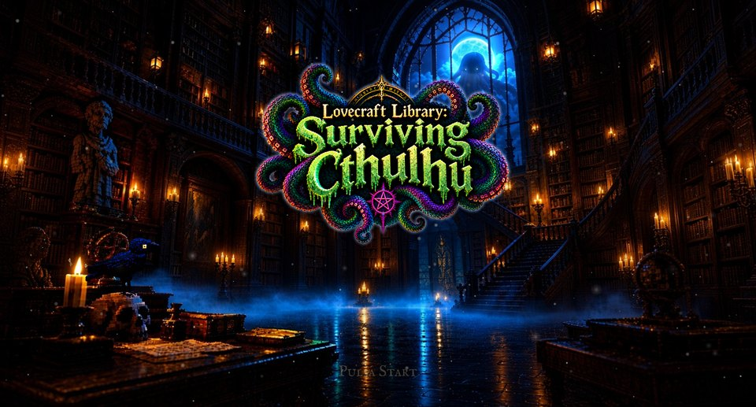

# Lovecraft Library: Surviving Cthulhu

**An isometric 3D voxel bullet hell with auto-fire and *survivors*-style progression, for 1 to 4 players in local and online co-op, set in H. P. Lovecraft's mythos.**

[](https://godotengine.org/)


[](LICENCIA.md)

[Español](README.md) · **English**

[Features](#features) · [Screenshots](#screenshots) · [Campaign](#the-campaign) · [Characters](#characters) · [Weapons](#weapons-and-items) · [Bestiary](#bestiary) · [Installation](#installation-and-running) · [Development](#for-developers) · [Roadmap](#roadmap)

</div>

> *"The most merciful thing in the world, I think, is the inability of the human mind to correlate all its contents."*
> — H. P. Lovecraft, *The Call of Cthulhu*

In the Library of Miskatonic University, a handful of investigators have begun to correlate them. From Antarctica to Innsmouth, and from Innsmouth to R'lyeh, something very old is waking up.

**Lovecraft Library** follows three of Lovecraft's stories (*At the Mountains of Madness*, *The Shadow over Innsmouth* and *The Call of Cthulhu*) across fifteen levels and three colossal bosses. Your weapons fire on their own: the skill lies in **moving and dodging** through hordes and curtains of bullets that drain your **health** or your **sanity**. When sanity hits zero, madness follows.

<div align="center">

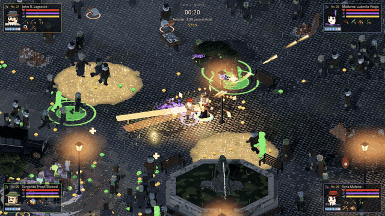

| 15 | 3 | 13 | 50 + 50 | 50 | 16 | 47 | 1–4 |
|:-:|:-:|:-:|:-:|:-:|:-:|:-:|:-:|
| levels | colossal bosses | investigators | weapons and their evolutions | items | companions | creatures | players, local or networked |

</div>

> [!NOTE]
> **Version 0.9.0, in development.** The full campaign can be played from start to finish: all three parts, solo, in local co-op or over the network. Still to come: the online test between different homes, final balancing with real players, the itch.io release and switching on cloud saves, which are already built. The detailed status is in the [roadmap](#roadmap).

> [!IMPORTANT]
> **The game is currently in Spanish only.** The names of characters, weapons, items and creatures on this page are translated; the screenshots show them as they appear in the game.

## Contents

- [Features](#features)
- [Screenshots](#screenshots)
- [The campaign](#the-campaign)
- [Characters](#characters)
- [Companions](#companions)
- [Weapons and items](#weapons-and-items)
- [Bestiary](#bestiary)
- [How to play](#how-to-play)
- [Installation and running](#installation-and-running)
- [Playing online](#playing-online)
- [For developers](#for-developers)
- [Roadmap](#roadmap)
- [Rights and credits](#rights-and-credits)
- [License](#license)

## Features

### Gameplay

- **Bullet hell with *survivors* progression:** hordes that pour in from off-screen, bullet patterns telegraphed on the ground and weapons that fire on their own. Each level lasts about five minutes and ends with a final event: a unique being, a horde to survive or one of the three bosses.
- **Health and sanity:** physical attacks (red, orange and yellow) take health; mental attacks (purple and lilac) take sanity; mixed ones take both. Being near the horrors wears the mind down too.
- **Madness crises:** at zero sanity, the investigator suffers one of five crises (paralysis, hysterical flight, aimless wandering, delirium with inverted controls, or paranoia), with a purple aura and a panicked face.
- **50 weapons with evolutions:** firearms, physical and magic, four at once (six with the holsters from the shop). Each one levels from 1 to 5 and, at max level and with its paired item, evolves into a new weapon when you open an arcane chest. Magic weapons cost sanity.
- **50 items** that bend the rules: projectiles, range, criticals, double dodges, shields, decoys, resurrection…
- **13 investigators** with seven attributes, a starting weapon, a trait of their own and their own dodge style: slide, roll, dive, jump or flash.
- **16 companions** that bite, heal, steal, swallow bullets or teleport.
- **Living levels:** snowfall, blizzards, fog, rain and thunderstorms; water that slows you down, waves that sweep the deck, devouring Angles that swallow whoever stays inside, arcane chests and breakable scenery; birds, bats and critters that react to the battle.
- **Three difficulties:** Investigator, Normal and Nightmare.

### Co-op, local and online

- **1 to 4 players** with gamepad or keyboard on the same PC, over the network between several PCs, or a mix of both (for example, two on the couch and two more, each in their own home).
- Shared camera, **shared experience** and **turn-based** level-ups: one player levels up at a time, in a window of their colour.
- Fallen players stay down for a few seconds and a teammate can **revive** them; staying next to a teammate in crisis shortens it.
- **Online** with a host and up to three guest PCs (ENet): rooms by **8-letter code**, IP or automatic port forwarding (UPnP), each PC with its own camera and save, and a bot that takes the place of anyone who disconnects until they come back.

### Progress and menus

- **Three save slots**, each with its own money, unlocks and achievements, plus a **cloud copy** in your GitHub account (a secret gist) to carry on from another PC; if a save has changed on two PCs, the game asks which one to keep ([guide](docs/GUARDADO_NUBE.md), in Spanish).
- **Antique shop:** permanent boosts, characters, companions and **outfits** (26 pieces shown on the model).
- **The Library:** bestiary, arsenal and places, with 1920s journal notes and maps of every level.
- **18 achievements** with rewards, an intro and **stories** that tell each level before you play it.
- **Four-player selection screen:** each player joins with Start, picks a character and a companion, and rotates them to see every side.
- **Accessibility:** interface size, high-contrast bullets, fewer flashes and adjustable camera shake. Remappable gamepad and keyboard controls.

### Tech

- **All 3D art is generated by code:** every character, creature, prop and level comes from a Python script that places the voxels (48 per metre for characters and companions). Nothing is modelled by hand in an editor.
- **Voxel meshes** with hidden-face culling, per-vertex ambient occlusion, an emissive layer and a disk cache. Animation by parts, with no rigging, using layers and blends.
- **Thousands of bullets without one node per bullet:** packed arrays, a spatial grid and `MultiMesh`. Voxel weapon effects (flames, smoke, acid, explosions) with shared particles.
- **Physics interpolation** for displays above 60 Hz, with physics at 60 Hz.
- **Data before code:** characters, weapons, enemies, patterns, levels, arenas, companions, items, achievements, shop and texts are `.tres` resources or JSON. A new enemy can be added without touching code.
- **Host-authoritative networking:** each PC decides the hits its own players take (what you dodge on screen is what counts) and the host rules the world, with 20 Hz interpolated snapshots and about 19 kB/s per guest.
- **Balancing with simulations:** a bot that dodges and picks upgrades (`SmartBot`) plays hundreds of games in parallel to measure every level and difficulty.

## Screenshots

| | |
|:---:|:---:|
| 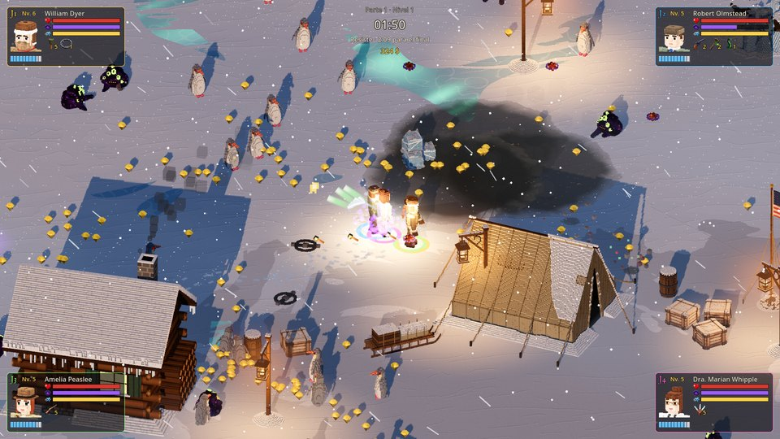 | 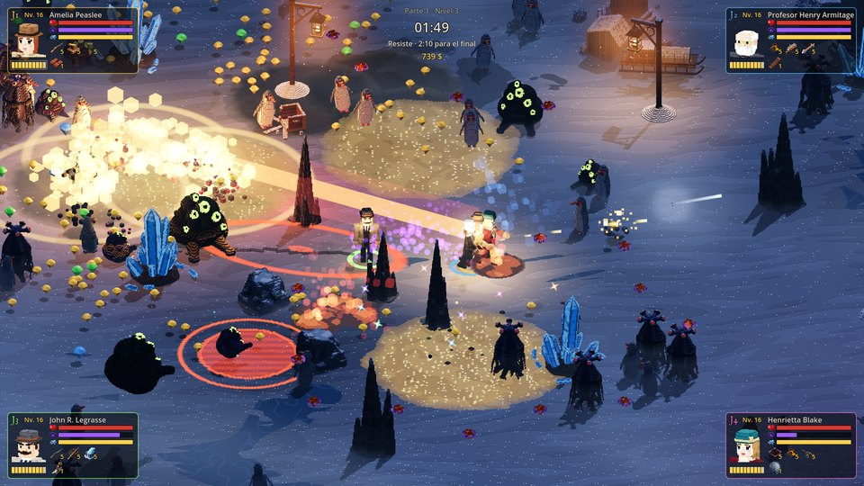 |
| **Part 1 · Base camp.** Blind albino penguins and protoplasmic fragments between the hut and the tents, on the Ross Sea coast. | **Part 1 · The mountain pass.** Crystals, rock spires and shoggoths in the cavern mist. |
| 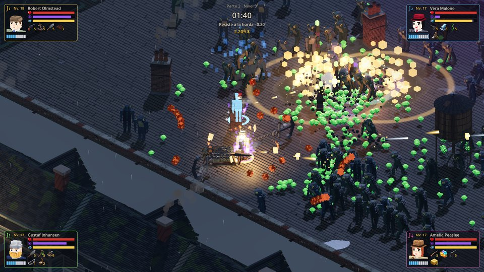 | 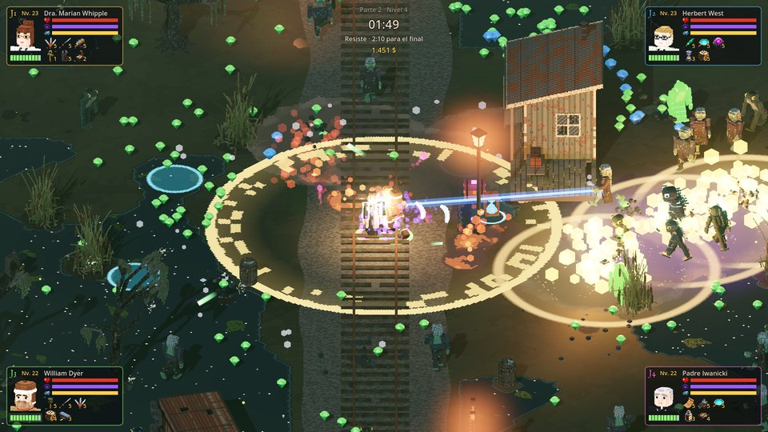 |
| **Part 2 · The rooftop escape.** The Devil Reef horde climbs onto the roof of the Gilman House: hold out for one minute. | **Part 2 · The railway to Rowley.** The railway embankment between slowing waters and Deep Ones rising from the marsh. |
| 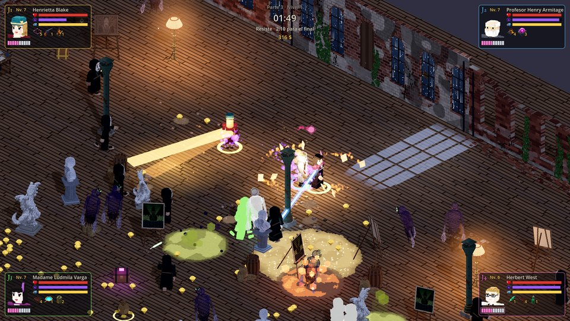 | 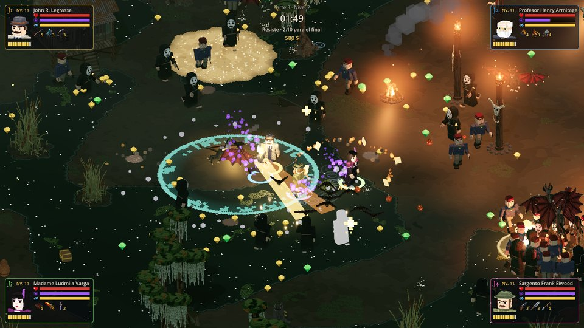 |
| **Part 3 · Wilcox's studio.** Sculptures, easels and nightmares from the wave of dreams, in Providence. | **Part 3 · The swamp ritual.** Bonfires, armed cultists from the *Alert* and bat-winged devils. |
| 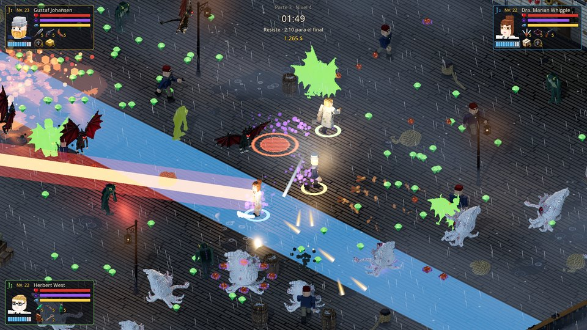 | 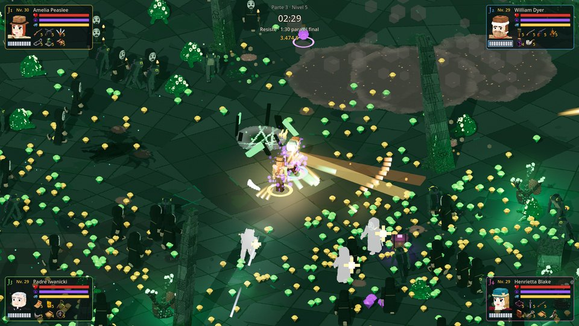 |
| **Part 3 · The storm in the Pacific.** A wave sweeps the deck as the white polypous thing rises. | **Part 3 · R'lyeh risen.** Flagstones that don't add up, lesser Old Ones and emanations of the colossal door. |

### The bosses

| The primordial shoggoth | Father Dagon | Cthulhu |
|:---:|:---:|:---:|
| 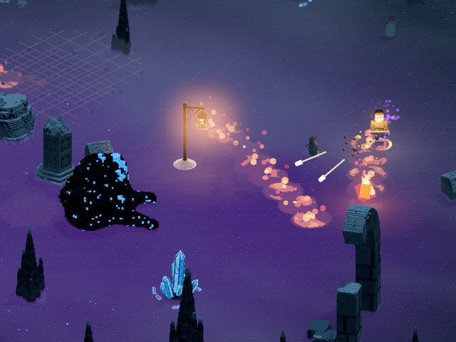 | 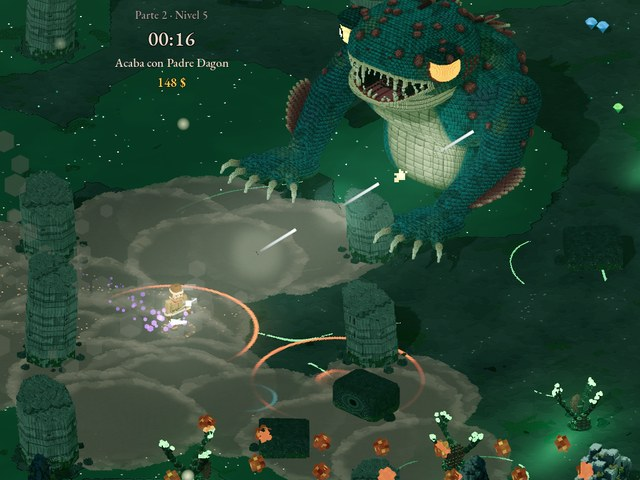 | 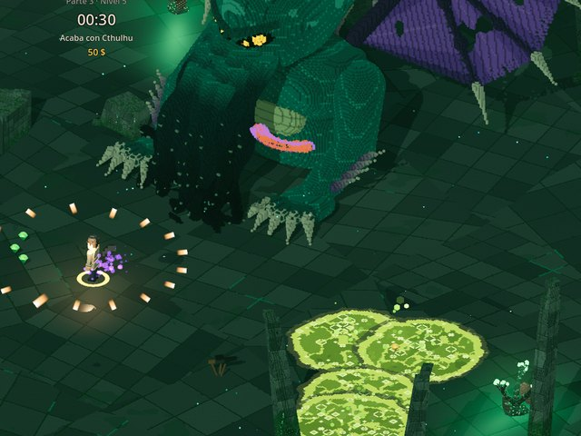 |
| Chases you through the tunnels of the underground sea, crying "Tekeli-li!". | Rises from the depths of Devil Reef, slams with his hands and calls the Deep Ones. | Looms through the door of R'lyeh, sweeps with his tentacles and, when he falls, re-forms once. |

### Menus

| | |
|:---:|:---:|
| 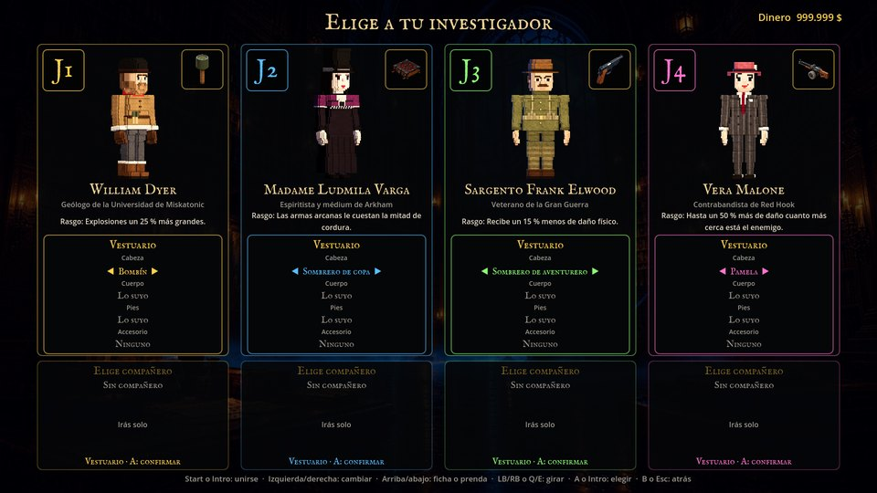 | 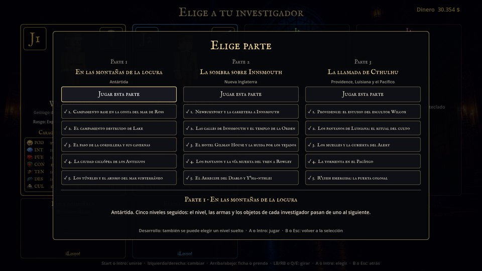 |
| **Selection.** Up to four players pick character, outfit and companion at the same time, each with their own gamepad. | **The map.** Three parts of five levels that open as you beat the previous one. |
| 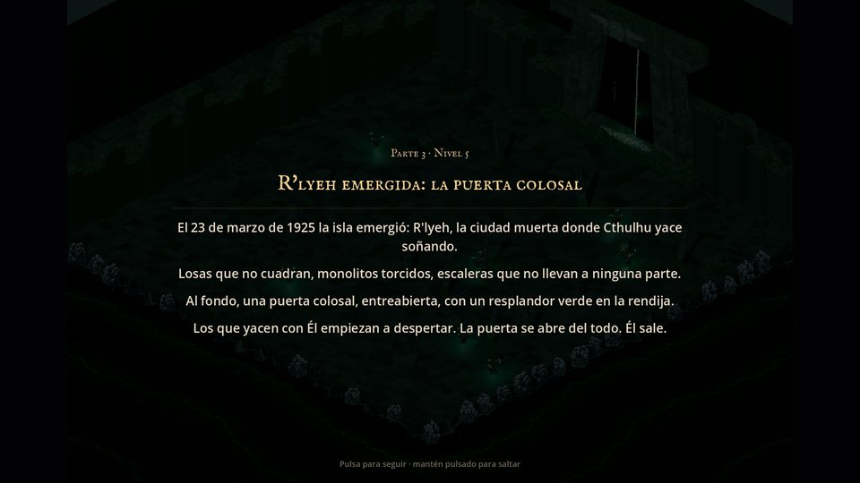 | 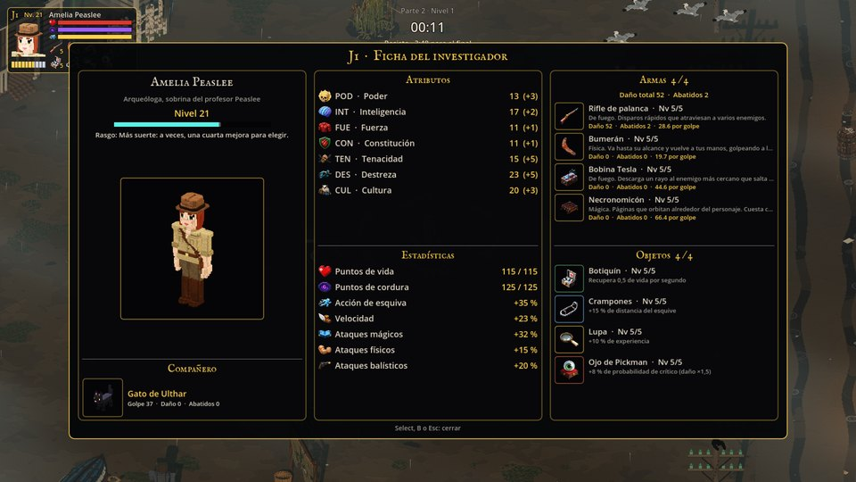 |
| **Stories.** Each level is told before you play it, over a map of the place. | **The character sheet** in-game: attributes, weapons and items. |
| 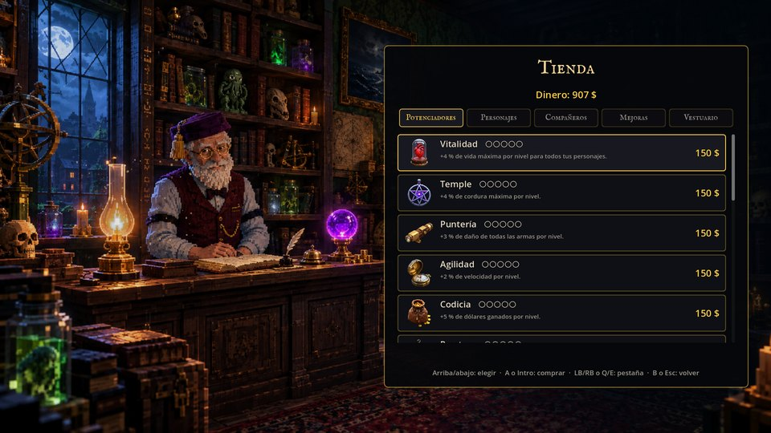 | 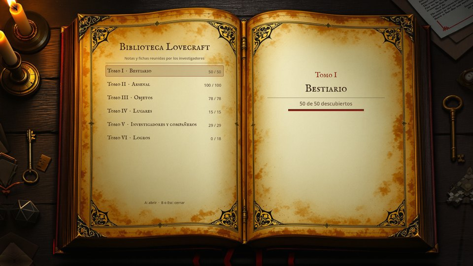 |
| **The antique shop,** with the old man behind the counter. | **The Library:** bestiary, arsenal and places, with journal notes. |
| 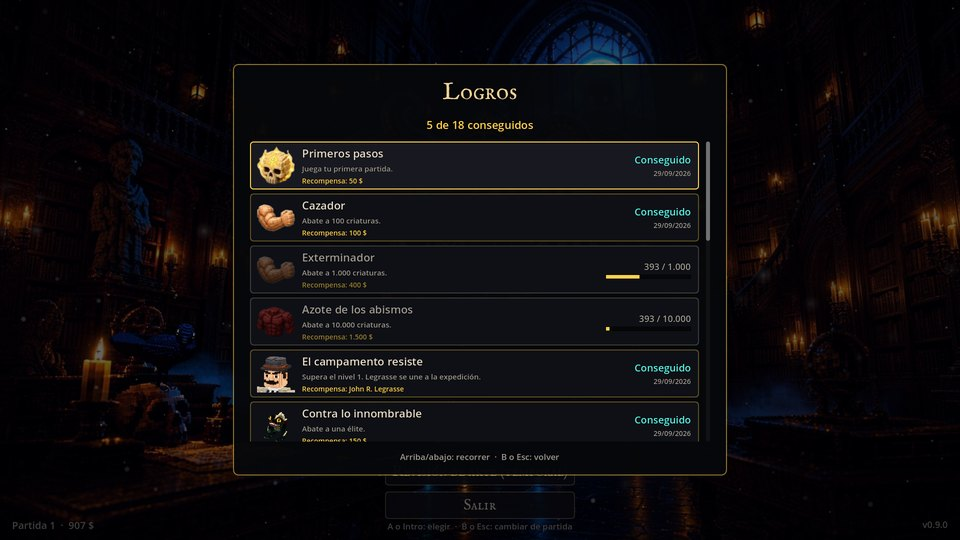 | 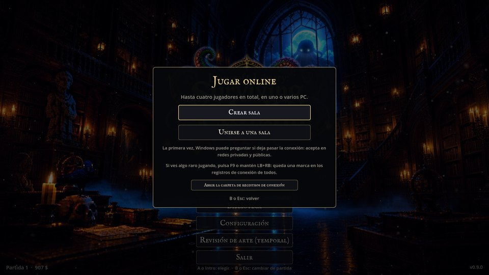 |
| **Achievements,** with their reward and progress. | **Play online:** create a room or join one with its code. |

## The campaign

Three parts of five levels. Each level opens when you beat the previous one, and each part when you beat the previous part. Every part starts again with the weakest creatures, but is harder than the last one, counting what you have bought in the shop.

### Part 1 · *At the Mountains of Madness* (Antarctica)

| Level | Creatures | Final event |
|---|---|---|
| 1. Base camp on the Ross Sea coast | Blind albino penguins, protoplasmic fragments | The Lurker |
| 2. Lake's ruined camp | Revived Elder Things, winged Elder Things | The first to awaken |
| 3. The mountain pass and its caverns | Slave shoggoths, mimic shoggoths | The cavern shoggoth |
| 4. The Cyclopean city of the Elder Things | Elder Thing warriors, mutilated Elder Things | The city's guardian |
| 5. The tunnels and the abyss of the underground sea | Glowing-eyed shoggoths, Elder Things of the abyssal sea | **Boss: the primordial shoggoth** |

### Part 2 · *The Shadow over Innsmouth* (New England)

| Level | Creatures | Final event |
|---|---|---|
| 1. Newburyport and the road to Innsmouth | Innsmouth townsfolk, acolytes of the Order of Dagon | The Order's deacon |
| 2. The streets of Innsmouth and the Order's temple | Advanced hybrids, tiara priests | The Order's high priest |
| 3. The Gilman House and the rooftop escape | Deep Ones, spitting Deep Ones, the Lurker | Survive the Devil Reef horde |
| 4. The marshes and the abandoned railway to Rowley | Elder Deep Ones of Y'ha-nthlei, marsh Deep Ones | Barnabas Marsh, transformed |
| 5. Devil Reef and Y'ha-nthlei | Pth'thya-l'yi, Mother Hydra | **Boss: Father Dagon** |

### Part 3 · *The Call of Cthulhu* (Providence, Louisiana and the Pacific)

| Level | Creatures | Final event |
|---|---|---|
| 1. Providence: the sculptor Wilcox's studio | Nightmares from the wave of dreams, cultists | The nightmare of the bas-relief |
| 2. The Louisiana swamps: the cult's ritual | Bat-winged devils, armed cultists from the *Alert* | The ritual's priest |
| 3. The docks and the deck of the *Alert* | Spawn of Cthulhu, Deep One servants | The greater spawn |
| 4. The storm in the Pacific | The white polypous thing, devouring Angles | The white thing of the hidden lake |
| 5. R'lyeh risen: the colossal door | Lesser Old Ones, emanations of the door | **Boss: Cthulhu** |

## Characters

All of them come from Lovecraft's stories or are invented relatives and acquaintances of his characters. You start with four (Dyer, Olmstead, Peaslee and Whipple); the rest are bought in the shop.

Each investigator has **seven attributes** (Power, Intelligence, Strength, Constitution, Tenacity, Dexterity and Culture), at 10 plus 20 points spread according to their background. They determine health, sanity, dodge, speed and the damage of each weapon type, and each level-up adds one more point.

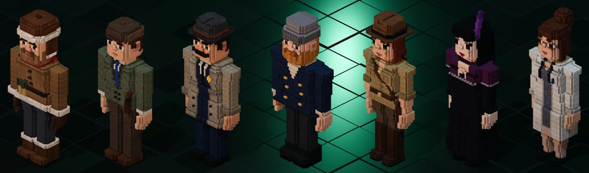
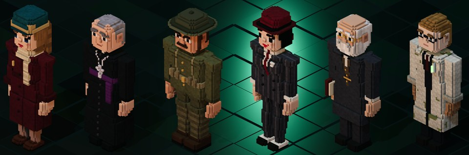

The faces are drawn by hand, voxel by voxel, on the model's own head: eyebrows, eyes with irises, raised noses, moustaches, glasses, freckles and lips.

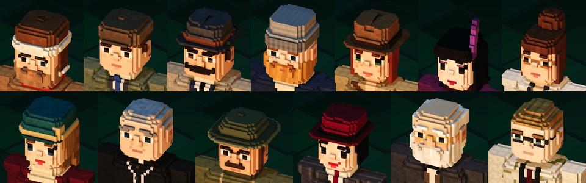

| Character | Starting weapon | Trait | Dodge | Source story |
|---|---|---|---|---|
| **William Dyer**, Miskatonic geologist | Stielhandgranate | Explosions 25 % bigger | Slide | *At the Mountains of Madness* |
| **Robert Olmstead**, traveller and narrator of Innsmouth | Webly Mk VI | Dodge 30 % longer | Roll | *The Shadow over Innsmouth* |
| **Amelia Peaslee**, archaeologist | Lever-action rifle | More luck: sometimes a fourth upgrade to choose from | Roll | *The Shadow out of Time* |
| **Dr. Marian Whipple**, physician | Scalpels | Revives teammates 50 % faster | Jump | *The Shunned House* |
| **John R. Legrasse**, New Orleans police inspector | Pump-action shotgun | 25 % more damage against cultists and humans | Jump | *The Call of Cthulhu* |
| **Gustaf Johansen**, second mate of the *Emma* | Machete | 25 % more melee damage | Dive | *The Call of Cthulhu* |
| **Madame Ludmila Varga**, Arkham medium | Necronomicon | Arcane weapons cost her half the sanity | Flash | Arkham medium |
| **Henrietta Blake**, writer | Trapezohedron | 15 % more experience per gem | Slide | *The Haunter of the Dark* |
| **Father Iwanicki**, priest of St. Stanislaus | Banishing formula | Calming aura: he and nearby teammates recover sanity | Roll | *The Dreams in the Witch House* |
| **Sergeant Frank Elwood**, Great War veteran | Mauser C96 pistol | 15 % less physical damage | Dive | *The Dreams in the Witch House* |
| **Vera Malone**, Red Hook smuggler | Thompson M1928 | Up to 50 % more damage the closer the enemy is | Slide | *The Horror at Red Hook* |
| **Professor Henry Armitage**, Miskatonic librarian | Powder of Ibn-Ghazi | Magic weapons recharge 20 % faster | Flash | *The Dunwich Horror* |
| **Herbert West**, reanimator | West's injector | On level-up, heals nearby teammates for 15 % of their health | Roll | *Herbert West—Reanimator* |

## Companions

Each player can bring one. They level up with you and are bought in the shop.

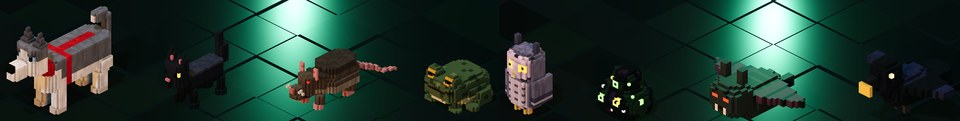
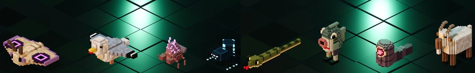

<details>
<summary><b>The 16 companions</b></summary>

| Companion | What it does |
|---|---|
| Lake's sled dog | Runs at nearby enemies and bites them, harder the higher your level. |
| Cat of Ulthar | Scratches anything that comes close; if you get hurt, it bristles and attacks twice as fast. |
| Rat in the Walls | Digs up dollars; sometimes, an arcane chest. |
| Innsmouth toad | Spits venomous slime that leaves a pool that damages and weakens. |
| Dream owl | 12 % more experience, up to 30 % as it levels up. |
| Baby shoggoth | Sticks to you and swallows enemy bullets that pass nearby. |
| Mini-Byakhee | Flies high and dives: an area hit that pushes. |
| Arkham raven | Brings you distant gems and steals a few coins on the way. |
| Moth of Leng | Its dust confuses groups: they wander aimlessly and don't shoot. |
| Innsmouth gull | Brings fish that restores health and sanity to whoever needs it most; screeches when it spots an elite. |
| Mini-Mi-Go | Fires beams at the nearest enemy. |
| Spider of Tindalos | Teleports behind an enemy, bites hard and stuns. |
| Serpent of Yig | Bites and poisons. |
| Innsmouth fish | Takes a run-up and rams whatever is in its path. |
| Mini-Dhole | Burrows and surfaces under groups of enemies: hits, pushes and stuns them. |
| Woodland goat | A charge that pushes and stuns. |

</details>

## Weapons and items

**50 weapons** (16 physical, 17 firearms and 17 magic), each with its evolution:

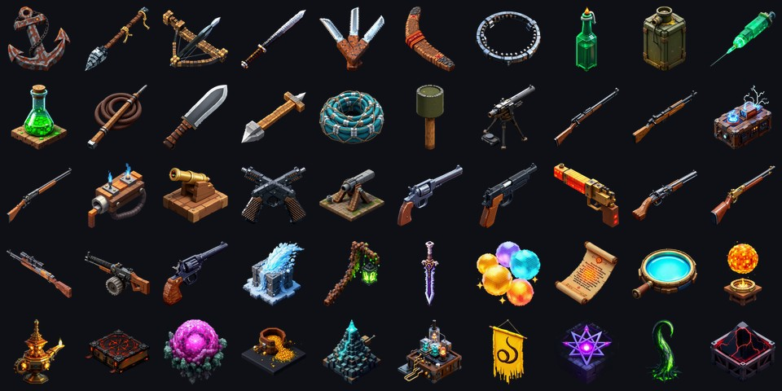

They all fire on their own, and each one's data decides how it aims: at the nearest enemy, at the densest area, at elites, around the character… They level from 1 to 5 and their damage grows with the attributes of their type. With the weapon at level 5 and its paired item, an arcane chest turns it into its **evolution**:

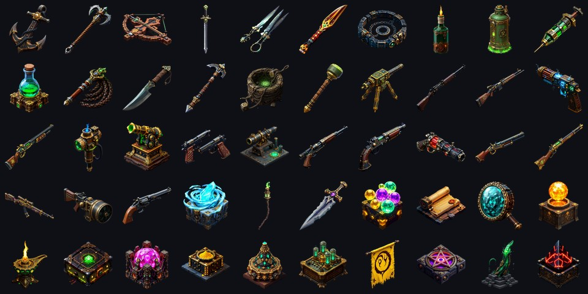

<details>
<summary><b>The 50 weapons and their evolutions</b></summary>

| Weapon | Type | How it works | Evolution (with) |
|---|---|---|---|
| The *Alert*'s anchor | Physical | An anchor on a chain that circles the character at long range, slow and heavy. | Johansen's anchor (Sealskin cuirass) |
| Whaling harpoon | Physical | Pierces and drags lesser enemies. | Nantucket harpoon (Plumb bob) |
| Crossbow | Physical | Bolts that pierce and pin the enemy for an instant. | Crossbow of fortune (Bone die) |
| Sword cane | Physical | A long thrust that pierces everything in its line. | Duelist's rapier (Whetstone) |
| Scalpels | Physical | A fan of piercing blades. | Surgical kit (Reindeer coat) |
| Boomerang | Physical | Flies out to its range and back, hitting both ways. | Bone boomerang (Pabodie's skis) |
| Leg-hold traps | Physical | Traps on the ground: the first enemy to step on one is caught and hurt. | Hunter's traps (Fang necklace) |
| Molotov cocktail | Physical | A bottle thrown in an arc that leaves a burning pool. | The *Emma*'s cocktail (Rum flask) |
| Chlorine gas | Physical | A toxic cloud that drifts toward enemies and poisons them. | Mustard gas (Curwen's elixir) |
| West's injector | Physical | An enemy killed with the serum rises as an ally for 6 s. | Perfected reagent (First-aid kit) |
| Chemical launcher | Physical | An acid flask: enemies in the pool take 25 % more damage. | Arkham apothecary (Laudanum) |
| Whip | Physical | A long lash in an arc ahead. | Tamer's whip (Lake's whistle) |
| Machete | Physical | A circular slash around the character. | Cane-field machete (Stevedore's gloves) |
| Geologist's hammer | Physical | A crack in a straight line that damages and stuns. | Ice Barrier hammer (Crampons) |
| Fishing net | Physical | Pins the densest group for 2 s; elites are only slowed. | Innsmouth net (Deep One scales) |
| Stielhandgranate | Physical | A stick grenade at the densest area; big explosion. | Shaped charge (Reflexes) |
| Lewis gun | Firearm | A tripod turret that fires at the nearest enemy on its own for 8 s. | Machine-gun nest (Marksmanship manual) |
| Mauser anti-tank rifle | Firearm | A very slow shot that pierces everyone in its line. | Anti-tank gun (Hunter's medallion) |
| BAR M1918 | Firearm | Bursts whose bullets ricochet to another enemy. | Assault BAR (Snow boots) |
| Tesla coil | Firearm | Lightning that jumps from enemy to enemy, up to four. | Nikola's coil (Dowsing rod) |
| Pump-action shotgun | Firearm | Pellets that spread in a ring around the character. | Trench shotgun (Bandolier) |
| Flammenwerfer | Firearm | A cone of fire that leaves the ground burning. | Breath of Moloch (Matches of Cthugha) |
| Fireworks | Firearm | Erratic rockets that burst into sparks. | Grand fireworks display (Firecrackers) |
| Dual Lugers | Firearm | Fire both where you're walking and behind you. | The ace's Lugers (Aviator goggles) |
| Stokes mortar | Firearm | A high-arc shell at the densest group; big explosion. | Mortar battery (Ponape powder) |
| Danforth's Nagant | Firearm | Fires faster and faster while it has targets. | Lookout's Nagant (Magnifying glass) |
| Mauser C96 pistol | Firearm | Short bursts of three tracers. | Tillinghast's Mauser (Tillinghast's watch) |
| Flare gun | Firearm | A flare that lures nearby enemies. | Lighthouse flare (Cloak of the Black Man) |
| Sawn-off shotgun | Firearm | Two blasts of pellets in a short cone with heavy knockback. | Smuggler's sawn-off (Shoggoth tooth) |
| Lever-action rifle | Firearm | Fast shots that pierce several enemies. | Miskatonic rifle (Field journal) |
| Springfield M1903 | Firearm | A slow shot that seeks out elites; sometimes, a triple critical. | Sniper's Springfield (Pickman's eye) |
| Thompson M1928 | Firearm | Tight bursts of small projectiles. | Chicago Thompson (Obed's gold) |
| Webly Mk VI | Firearm | Heavy rounds with knockback. | Lookout's revolver (Lake's compass) |
| Breath of Ithaqua | Magic | An icy wind in a cone that slows and freezes. | Breath of the Wendigo (Pemmican) |
| Lamplighter's staff | Magic | Will-o'-the-wisps that seek out enemies on their own. | Lantern of the wisps (Meerschaum pipe) |
| Ritual dagger | Magic | A curse that jumps to its neighbours if the enemy dies cursed. | Sacrificial dagger (Ghoul fang) |
| Sphere of Yog-Sothoth | Magic | A slow orb that pulls enemies into its centre and grinds them. | The Gate and the Key (Silver key) |
| Banishing formula | Magic | A wave that pushes and stuns. | Greater exorcism (Elder Sign) |
| Aether lens | Magic | A sustained beam whose damage grows up to threefold. | Eye of the Aether (Spyglass) |
| Flame of Cthugha | Magic | A living fireball that pierces and leaves a burning trail. | Cult flame (Esoteric talisman) |
| Lamp of Alhazred | Magic | A beam of light that sweeps in a circle around the character. | Lamp of the Mad Arab (Ankh of Nephren) |
| Necronomicon | Magic | Pages that orbit the character. | Complete Necronomicon (Pnakotic manuscripts) |
| Mi-Go orb | Magic | An orb from Yuggoth that flies around you and fires on its own. | Swarm of Yuggoth (Crystal of Ithaqua) |
| Powder of Ibn-Ghazi | Magic | A cloud that slows and weakens those inside. | Powder of the Elder Things (Map of Leng) |
| Ray of Yith | Magic | Freezes in time; the damage lands at the end, 50 % higher. | Ray of the Great Race (Clepsydra of Yith) |
| Resonator | Magic | Its pulse dissolves nearby enemy bullets. | Great resonator (Shield of Nodens) |
| Yellow Sign | Magic | Those who look at it go mad and attack their own. | The King in Yellow (Psalter) |
| Arcane Sign | Magic | A sign on the ground that damages, pushes and slows enemy bullets. | Greater Sign (Scapular) |
| Tentacles of Shub | Magic | Tentacles that burst from the ground beneath random enemies. | The Thousand Young (Eltdown tablet) |
| Trapezohedron | Magic | A ray of concentrated light that damages everything it passes through. | Awakened trapezohedron (Idol of Cthulhu) |

</details>

**50 items**, from level-ups (permanent boosts are bought in the shop):

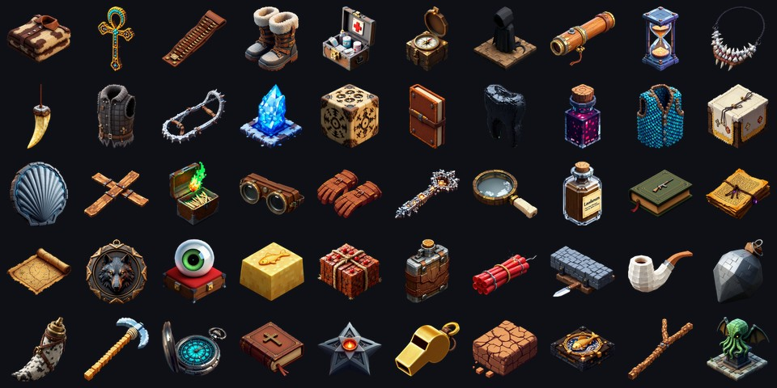

<details>
<summary><b>The 50 items</b></summary>

| Item | Effect |
|---|---|
| Reindeer coat | +20 max health |
| Ankh of Nephren | Once per level, when you fall you get back up with 30 % health |
| Bandolier | +1 projectile for bullet and thrown weapons |
| Snow boots | +8 % walking speed |
| First-aid kit | Recovers 0.5 health per second |
| Lake's compass | +30 % experience pickup radius |
| Cloak of the Black Man | Dodging leaves a decoy that lures enemies |
| Spyglass | +10 % weapon range |
| Clepsydra of Yith | +15 % duration of zones, orbits, beams and turrets |
| Fang necklace | +25 % critical damage |
| Ghoul fang | Each kill heals 0.15 health |
| Sealskin cuirass | −2 physical damage from each hit |
| Crampons | +15 % dodge distance |
| Crystal of Ithaqua | 6 % chance for a hit to slow the enemy for 1.5 s |
| Bone die | +15 % luck: sometimes one more option on level-up |
| Field journal | +20 max sanity |
| Shoggoth tooth | +20 % damage below 30 % health |
| Curwen's elixir | +15 % damage for 2 s after dodging |
| Deep One scales | Returns 30 % of contact damage |
| Scapular | +25 % invulnerability after taking a hit |
| Shield of Nodens | Absorbs an entire hit every 25 s |
| Pabodie's skis | +1 consecutive dodge before recharging |
| Matches of Cthugha | 6 % chance for a hit to set the enemy on fire for 3 s |
| Aviator goggles | +0.08 s of invulnerability when dodging |
| Stevedore's gloves | +12 % physical damage and +10 % knockback |
| Silver key | New options on a level-up, once per level |
| Magnifying glass | +10 % experience |
| Laudanum | Madness crises last 20 % less |
| Marksmanship manual | +12 % firearm damage |
| Pnakotic manuscripts | +12 % magic weapon damage |
| Map of Leng | +10 % area for explosions, zones, waves and slashes |
| Hunter's medallion | +30 % damage to elites and unique beings |
| Pickman's eye | +8 % critical chance (×1.5 damage) |
| Obed's gold | +15 % dollars for the team |
| Pemmican | Food and potions heal 30 % more |
| Rum flask | +8 % damage |
| Firecrackers | Dodging sets off a charge where you were |
| Whetstone | Bullets pierce 1 more enemy |
| Meerschaum pipe | Recovers 0.6 sanity per second |
| Plumb bob | +25 % knockback |
| Ponape powder | +12 % projectile speed |
| Reflexes | Dodge recharges 10 % faster |
| Tillinghast's watch | Weapons recharge 6 % faster |
| Psalter | Each kill restores 0.12 sanity |
| Elder Sign | −10 % mental damage, auras included |
| Lake's whistle | +20 % companion damage and speed |
| Eltdown tablet | 8 % chance for a killed enemy to explode and damage those nearby |
| Esoteric talisman | Magic weapons cost 12 % less sanity |
| Dowsing rod | Arcane chests appear 15 % more often |
| Idol of Cthulhu | +12 % enemies, experience and dollars |

</details>

## Bestiary

47 creatures, 18 of them unique beings (mini-bosses and bosses). Each has its tier (1 to 5), its behaviour and its attack pattern, all in data. Low-tier creatures make up the bulk of the horde; tiers 4 and 5 are elites.

**Part 1:** blind albino penguin, protoplasmic fragment, revived Elder Thing, winged Elder Thing, slave shoggoth, Elder Thing warrior, mutilated Elder Thing, glowing-eyed shoggoth and Elder Thing of the abyssal sea.

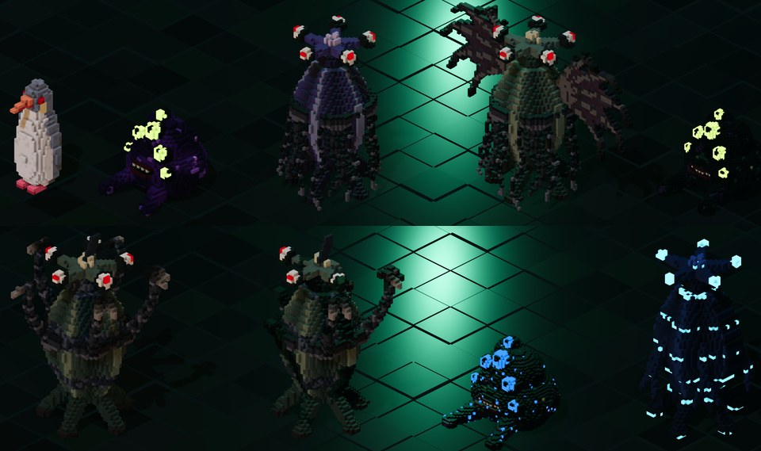

**Part 2:** old man and woman of Innsmouth, acolyte of the Order of Dagon, advanced hybrids, tiara priest, Deep One, spitting Deep One, elder Deep One of Y'ha-nthlei and the Lurker.

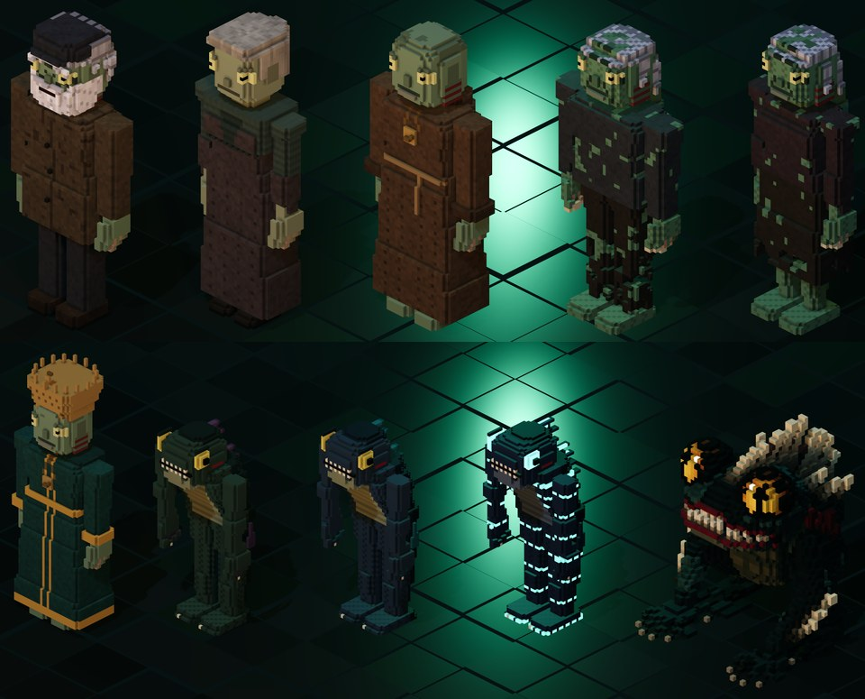

**Part 3:** Cthulhu cultist, armed cultist from the *Alert*, nightmare from the wave of dreams, bat-winged devil, spawn of Cthulhu, the white polypous thing, emanation of the door and lesser Old One.

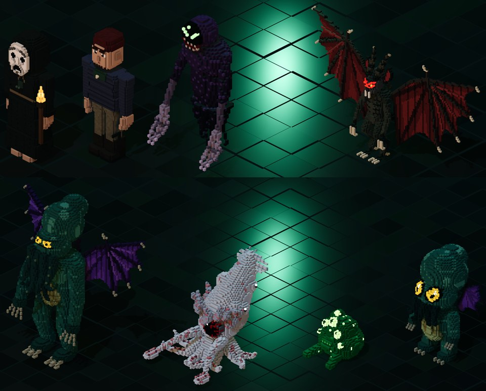

Some have behaviours of their own: the blind penguin heads to where it last heard the player, the mimic shoggoth disguises itself as an Elder Thing and transforms as you approach, nightmares pass through scenery, devils dive from above and marsh Deep Ones rise out of the water. The devouring Angles of R'lyeh can't be killed: they must be dodged.

## How to play

### Controls

| Action | Gamepad | Keyboard |
|---|---|---|
| Move | Left stick or D-pad | WASD or arrow keys |
| Dodge | A | Space |
| Shoot | Automatic | Automatic |
| Character sheet | Select | Tab |
| Arena map | D-pad down | M |
| Sheet pages / rotate on the selection screen | LB / RB | Q / E |
| Pause | Start | Esc |
| Menus: confirm / back | A / B | Enter / Esc |
| Selection: join | Start | Enter |

Everything can be remapped, on keyboard and gamepad, under **Settings → Controls**.

### Health, sanity and madness

- **Health:** drops with physical damage. In co-op, at zero you are downed for a few seconds and a teammate can revive you.
- **Sanity:** drops with mental attacks, with the presence of nearby horrors and with arcane weapons. It recovers away from enemies.
- **Madness crises** (4 to 6 seconds, at zero sanity):

| Crisis | Effect |
|---|---|
| Catatonic paralysis | Freezes in place for brief moments, warned by a tremor. Keeps shooting. |
| Hysterical flight | Runs uncontrollably away from the nearest horror. |
| Aimless wandering | Slow, erratic movement; the controls only half obey. |
| Delirium | Inverted controls. |
| Paranoia | Their weapons aim at teammates and drain their sanity (co-op only). |

- **Readability:** low-sanity effects never hide or fake the real bullets.

### Levelling up

Experience gems are shared by the team. On a level-up, the player whose turn it is chooses between three options (four with luck): a new weapon, upgrading one they already carry, or an item. Arcane chests with treasure appear throughout the levels; a level 5 weapon carrying its paired item evolves when the next one is opened.

## Installation and running

### From source

Requirements: [Godot 4.4.1](https://godotengine.org/download/archive/4.4.1-stable/) (standard version, not .NET) and a Vulkan-capable graphics card (Metal on Mac). Optional, to regenerate models, levels and images: Python 3.12 with `numpy`, `scipy` and `Pillow`.

```bash
git clone https://github.com/sergiosanchezcustodio/lovecraft-bullethell.git
cd lovecraft-bullethell
godot --headless --path . --import   # first time only: imports the resources
godot --path .                       # credits card, intro, title screen, save slots, main menu
```

On Windows you can also just double-click `jugar.cmd`. The game starts in fullscreen; to play in a window, use `godot --path . -- window=true`. The first game takes a few extra seconds to start because it builds the model meshes, which are then cached.

### Executables

With the Godot 4.4.1 export templates installed:

```bash
sh tools/exportar.sh          # compresses the models and exports Windows and macOS builds to builds/
```

This produces a single `.exe` for 64-bit Windows 10/11 and a universal `.app` for macOS 11 or later (Apple Silicon and Intel). The Mac version isn't signed with an Apple developer account: the first time, open it with **right-click → Open**.

## Playing online

Up to four players spread across one to four PCs. One PC creates the room (**Jugar → Jugar online → Crear sala**, "Play → Play online → Create room") and shares its **8-letter code** with the others, who join with it. If the router opens the port by itself (UPnP), the code works from anywhere; otherwise, open port 24680 manually or use a virtual private network.

- Everyone needs the **same version** of the game (shown at the bottom right of the main menu).
- The room is the character selection screen itself: each PC picks with its own unlocks and the host chooses the level.
- Each PC has its own camera, its HUD with ping, and its own save (money and achievements).
- If someone disconnects, a bot takes their place, and they can come back at the next level.
- Holding **F9** or **LB+RB** drops a marker in the network log of every PC, so you can discuss later what happened.

Full guide for players (in Spanish) in [`docs/JUGAR_ONLINE.md`](docs/JUGAR_ONLINE.md).

## For developers

The code, comments and internal documentation are in Spanish.

### Structure

```
addons/      GUT (tests)
data/        Game data: characters, weapons, enemies, patterns, levels, arenas,
             companions, items, outfits, shop, achievements, weather, ambience, campaign and texts
docs/        Design (GDD), roadmap, journal, lessons, performance, guides and images
models/      Voxel models in JSON (generated by the scripts in tools/)
resources/   Illustrations, masks, icons, music, sounds and fonts
scenes/      main (router), title, select, relato, game, preview and bench
scripts/     Code by system: anim, bullets, core, enemies, fx, input, level, menus, net,
             pets, player, progression, save, title, ui, weapons
tests/       GUT tests
tools/       Generators for models, levels, effects, icons and images; simulations
```

### Voxel art pipeline

1. **Python generator** (`tools/gen_*.py`, built on `tools/voxlib.py`, plus `tools/cuerpo.py` for humans): builds the model from primitives and flat-faced sections, colours it by material and paints the details. Faces are drawn row by row, like a sprite, onto the head.
2. **JSON** (`models/*.json`): a list of voxels `[x, y, z, part, r, g, b, glow]` and one pivot per part.
3. **`VoxelBuilder`** turns the JSON into meshes: it culls hidden faces, computes per-vertex ambient occlusion, separates the emissive layer and caches the result.
4. **Animation in code:** each model family has its script in `scripts/anim/`, which rotates the parts according to the animation phase.
5. **Levels** from recipes (`tools/arena_kit.py`): ground, borders, light, weather, scattered props and a walkability map built from each piece's actual voxels.
6. **References and icons** with FLUX: locally with ComfyUI (`tools/generar_local.py`) or, with permission, on Replicate. References guide the design; the models always come from the generator.

```bash
python tools/gen_dyer.py                              # regenerate a character
python tools/gen_vestuario.py                         # and then its outfits
python tools/gen_arena_campamento.py                  # level 1 arena and its map
godot --path . -- still 0 dyer,olmstead,legrasse      # screenshot of one or more models
godot --path . -- anim 45 dyer walk                   # frames of an animation
```

### Launch options

Scenes read whatever comes after `--`. Some useful ones:

```bash
godot --path . -- title                                         # title screen
godot --path . -- select join=3                                 # selection screen with three test players
godot --path . -- level=p2_n2 bot=smart bots=3 autopick=true    # a game with four bots
godot --path . -- level=p3_n5 boss=true final_at=5 god=true     # straight to Cthulhu
godot --path . -- character=legrasse nolevel=true cam=3.5       # test field, close up
godot --path . -- select net_host=true net_upnp=false           # test online room (and another window with net_join=127.0.0.1)
godot --path . --disable-vsync -- bot=circle god=true max_alive=150 spawn_rate=40 bullet_rain=1000 perf=10
                                                                # stress test
python tools/simular.py --ts 2 --par 2                          # balance simulations with SmartBot
```

The full list is in [`CLAUDE.md`](CLAUDE.md). In-game, **Pause → Debug** lets you change almost anything without restarting.

### Tests

```bash
godot --headless --path . -s addons/gut/gut_cmdln.gd
```

419 tests with [GUT 9.4](https://github.com/bitwes/Gut): movement, combat, bullets, weapons and evolutions, waves, progression, sanity, co-op, networking, companions, economy, shop, achievements, saves, cloud, settings, menus, content and animations. Visuals are checked with automatic screenshots from the terminal.

### Performance

Windows 11, RTX 3070 Ti, 1920 × 1080, Forward+, no vsync:

| Test | Average | 1 % low |
|---|---|---|
| Normal game: 75 enemies and 500 bullets, on any of the 15 levels | 107-119 FPS | 60-118 FPS |
| Stress test: 150 enemies and 1,000 bullets, one player | 82-90 FPS | 53 FPS |
| Stress test: 150 enemies and 1,000 bullets, four players | 65-69 FPS | 37-41 FPS |
| Network: four PCs with 75 live enemies | ~19 kB/s per guest | 0.46 ms of networking per frame |

Details in [`docs/RENDIMIENTO.md`](docs/RENDIMIENTO.md) and in the journal.

### Documentation (in Spanish)

- [`docs/GDD.md`](docs/GDD.md): living design document, with every decision.
- [`docs/ROADMAP.md`](docs/ROADMAP.md): phases, milestones, acceptance criteria and status.
- [`docs/ESTADO.md`](docs/ESTADO.md): detailed journal of every milestone and change.
- [`docs/LECCIONES.md`](docs/LECCIONES.md): technical lessons learned.
- [`docs/JUGAR_ONLINE.md`](docs/JUGAR_ONLINE.md) and [`docs/PRUEBA_ONLINE.md`](docs/PRUEBA_ONLINE.md): guide to playing online and checklist for the internet test.
- [`docs/GUARDADO_NUBE.md`](docs/GUARDADO_NUBE.md): guide to cloud saves (in Spanish).
- [`CLAUDE.md`](CLAUDE.md): current status, architecture, pipeline and commands.
- [`docs/PROMPT_juego_lovecraft.md`](docs/PROMPT_juego_lovecraft.md): the original specification, unchanged.

### Images in this README

They come from automatic in-game screenshots: `sh tools/capturas_readme.sh` plays the games with bots and captures menus and models, and `python tools/montar_readme.py` scales them to 960 px, assembles the model, face and icon sheets (reading the same data the game uses) and uses ffmpeg to make the GIF and an MP4 video with sound. It also writes `docs/img/vista_previa.jpg` (1280 × 640), the image GitHub shows when the repository link is shared.

## Roadmap

| Phase | Content | Status |
|---|---|---|
| 0 | Documentation and decisions | ✅ Done |
| 1 | Playable prototype: one level, weapons, enemies, progression, sanity and HUD | ✅ Done |
| 2 | Menus, saves and local co-op: save slots, settings, four-player selection, revives, economy, shop, companions, achievements, weather and outfits | ✅ Done |
| 3 | Content pipeline: enemies, weapons, evolutions, levels and arenas as data | ✅ Done |
| 4 | Part 1: Antarctica, five levels and the primordial shoggoth | ✅ Done |
| 5 | Credits card, intro, stories for all 15 levels, expanded shop, Armitage and West | ✅ Done |
| 6 | Part 2: Innsmouth, five levels and Father Dagon | ✅ Done |
| 7 | Part 3: Providence, Louisiana, the Pacific, R'lyeh and Cthulhu | ✅ Done |
| 8 | Polish and release: sound, music, accessibility, 50 weapons and 50 items, rebuilt levels, voxel effects, difficulties, living ambience, turn-based level-ups, new faces | 🔨 In progress: final balancing with real games and the itch.io release remain |
| 9 | Online play: room, selection and networked game, pause and level-ups for everyone, disconnections and rejoining | ✅ Done, pending the internet test |
| 10 | Cloud saves: saves and controls copied to a GitHub gist, conflicts between PCs | ✅ Done, waiting to be switched on (GitHub app) and for the two-PC test |

## Rights and credits

- **Setting:** H. P. Lovecraft's stories are in the **public domain** in Spain and the European Union, and all of the game's content comes from them. The game is not affiliated with *Call of Cthulhu* (a trademark of Chaosium) and does not reproduce rules, texts or illustrations from the roleplaying game or from modern adaptations.
- **Engine:** [Godot Engine](https://godotengine.org/) (MIT license).
- **Tests:** [GUT](https://github.com/bitwes/Gut) (MIT license), in `addons/gut/`.
- **Title screen font:** *IM FELL English SC*, by Igino Marini, under the [SIL Open Font License 1.1](resources/fonts/OFL_IMFellEnglishSC.txt).
- **Menu font:** *EB Garamond*, by Georg Duffner and Octavio Pardo, under the [SIL Open Font License 1.1](resources/fonts/OFL_EBGaramond.txt).
- **Sound effects:** [Kenney](https://kenney.nl/) (CC0) and synthesized for the game.
- **Music:** by the author (title screen and first level) and CC0 tracks from [OpenGameArt](https://opengameart.org/) by Eldritch Grim, Juhani Junkala, isaiah658 and others; the full list, with authors and links, is in [`data/musica.json`](data/musica.json).
- **Design, title screen and shop illustrations:** Sergio Sánchez Custodio.
- **Use of AI:** the code, the voxel models (generated by programs) and the texts are developed with [Claude Code](https://claude.com/claude-code) (Anthropic), under the author's direction. The weapon and item icons and the design references were generated with FLUX (Black Forest Labs), on [Replicate](https://replicate.com/) and locally with ComfyUI.

## License

Mixed license; details in [`LICENCIA.md`](LICENCIA.md).

- **The code** (scripts, shaders, scenes, tools, tests, gameplay data and documentation) is released under the **GNU General Public License v3.0**, full text in [`LICENSE`](LICENSE). You may copy, modify and redistribute it, even commercially, as long as anything you redistribute based on it is also released under GPL-3.0 with its source code.
- **The game's assets** (the art, the author's music, the game's texts and the name *Lovecraft Library: Surviving Cthulhu*) are **all rights reserved**. You may use them to play, build or test the project, but not to reuse them in other projects.
- Third-party components keep their own licenses (see [Rights and credits](#rights-and-credits)).
